---
# Reading the Signs
## How Clinical Markers Relate to Heart Disease
---

[Back to home](./)

**DATA 601: Working with Data and Visualization**  
**University of Calgary | Fall 2026**  
**Group project by:** Ahmed Muhammad, Joy Umejiego and Sandra Igboanugo

Across three projects, we explored the UCI Heart Disease dataset, built a decision tree classifier and investigated which clinical markers were associated with heart disease. Each part built on the previous work, including revisiting decisions about missing data when we saw how much they affected the patients included in the analysis.

**Tools:** Python, Pandas, NumPy, Matplotlib, Seaborn, scikit-learn and Jupyter/Google Colab.

[Part 1: Exploring the data](#part-1-exploratory-data-analysis) | [Part 2: Making predictions](#part-2-making-predictions) | [Part 3: Answering questions](#part-3-answering-questions) | [Project files](#project-files)

## The dataset

The dataset contains 920 patient records and 16 columns from four hospitals: Cleveland, Hungary, Switzerland and VA Long Beach. We used the UCI Heart Disease data distributed through Kaggle.

The records include age, sex, chest-pain type, resting blood pressure, cholesterol and exercise-test measurements. The diagnosis variable, `num`, ranges from 0 for no disease to 4 for increasing disease severity. For classification, we combined levels 1–4 into a single disease-present category.

These patients had already been referred for heart testing. The findings describe this clinical sample and should not be treated as estimates for the general population.

## Part 1: Exploratory Data Analysis

### What we investigated

We first examined the structure and quality of the data. We used summary statistics, distribution plots and Spearman correlations to explore how the measurements varied and how they related to disease severity.

### Data quality

Missing values differed considerably between hospitals. The vessel-count variable, `ca`, was recorded mainly in Cleveland, while Switzerland had no usable cholesterol readings. We also identified 172 cholesterol values recorded as zero and treated them as missing rather than genuine measurements.

This mattered because a chart or calculation could otherwise describe hospital recording practices rather than patient characteristics.

### Visual exploration

We used histograms and bar charts to examine distributions, and boxplots to compare clinical measurements across disease levels. We also considered how labels, filters and missing values could affect the way a reader interpreted each chart.

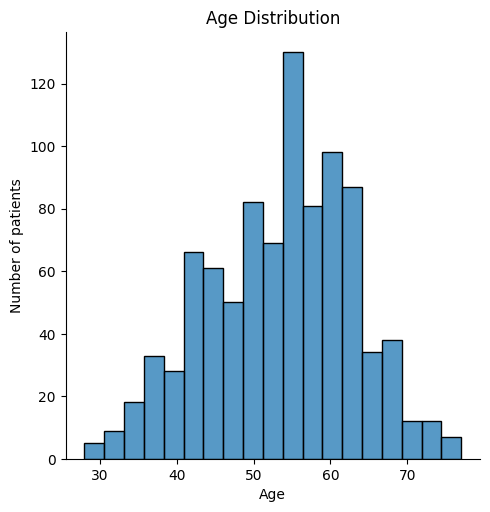

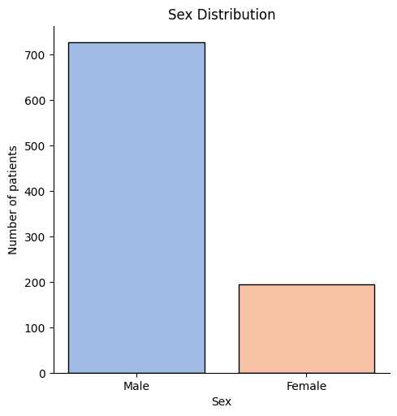

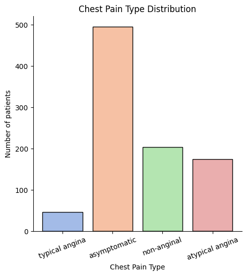

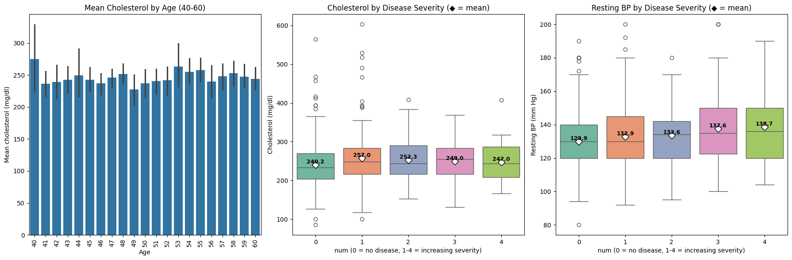

### Relationships between measurements

The vessel-count variable had a moderate positive correlation with disease severity, approximately 0.53. Maximum heart rate had a moderate negative correlation, approximately −0.40. Cholesterol and resting blood pressure showed weaker relationships than we initially expected.

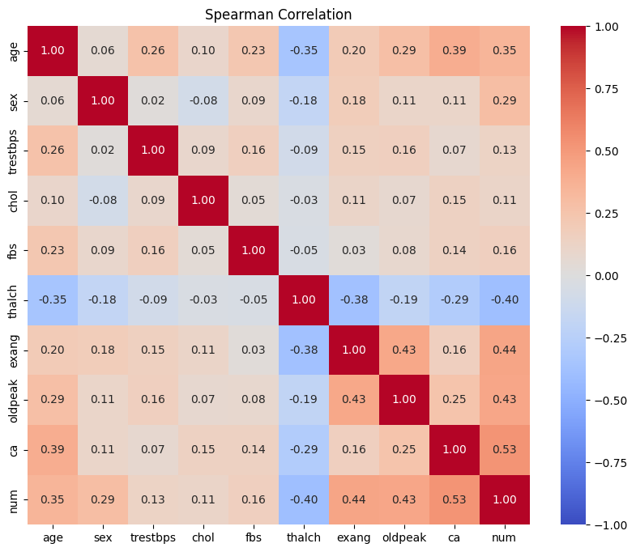

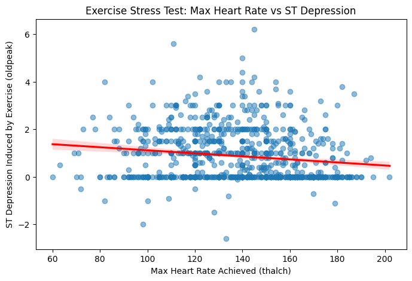

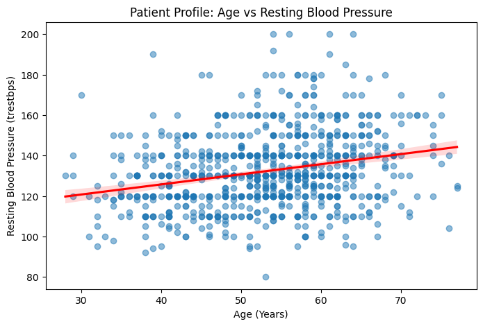

### What we learned

Checking distributions helped us identify values that would have distorted the analysis. Plot choice also mattered: boxplots made comparisons across disease levels easier to see than overlapping points in a scatterplot.

[View the Part 1 notebook](./files/data601/part1.ipynb)

## Part 2: Making Predictions

### Our question

Can we predict whether a patient has heart disease using their clinical measurements?

We used a decision tree classifier because we could visualize its questions and follow how it reached a prediction.

### Preparing the data

We retained `ca` because of its relationship with disease in Part 1. We dropped the largely incomplete `thal` and `slope` columns, then removed rows with missing values in the remaining analysis variables. This left 302 patients, including 299 from Cleveland.

We converted binary variables to numerical values, used one-hot encoding for nominal categories and created a binary disease indicator. Patient ID, hospital origin and the original diagnosis were excluded from the predictors.

We split the data into 80% training and 20% testing, maintaining the disease proportions in each group.

### Exploring the modelling sample

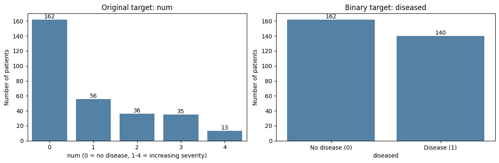

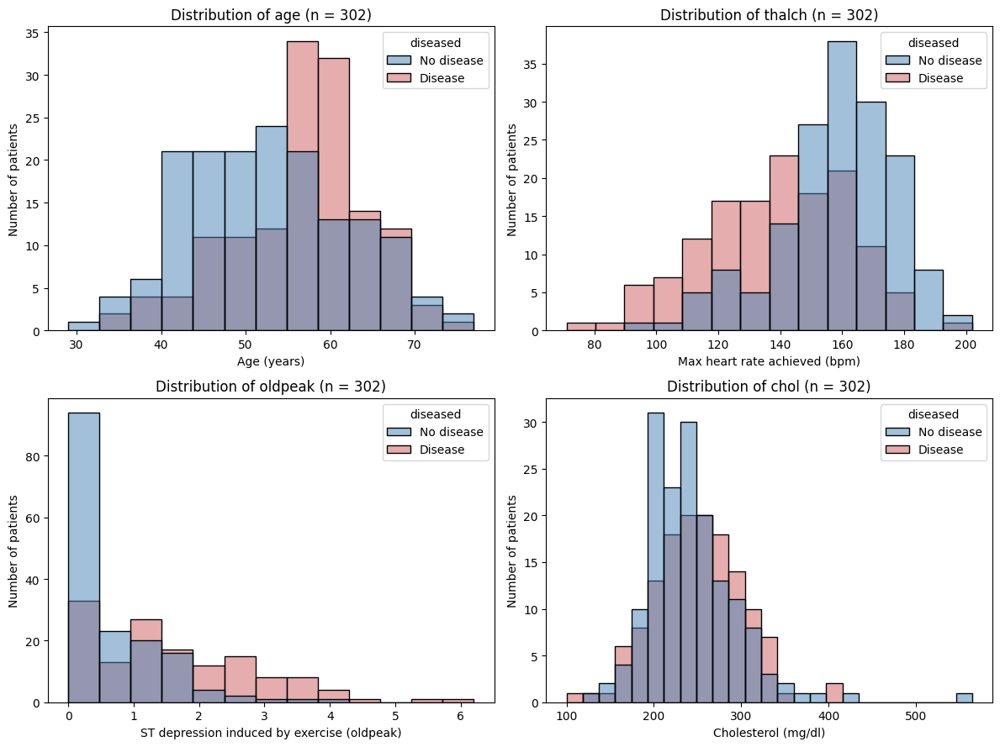

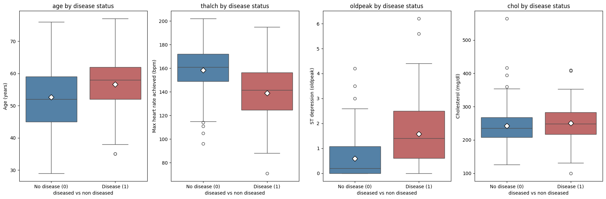

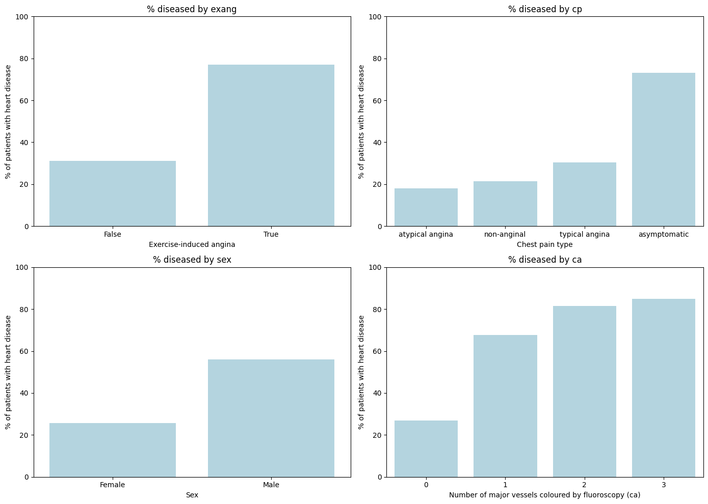

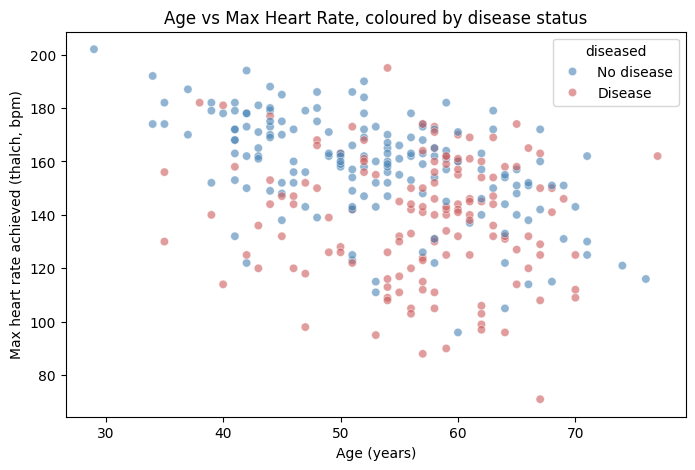

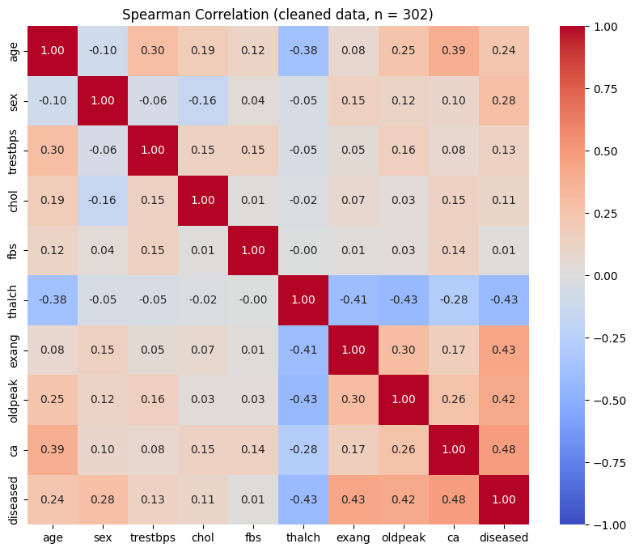

### Building the model

An unrestricted tree achieved perfect training accuracy but performed much worse on the testing data. We compared tree depths and selected a depth of 3 to keep the model relatively simple and readable.

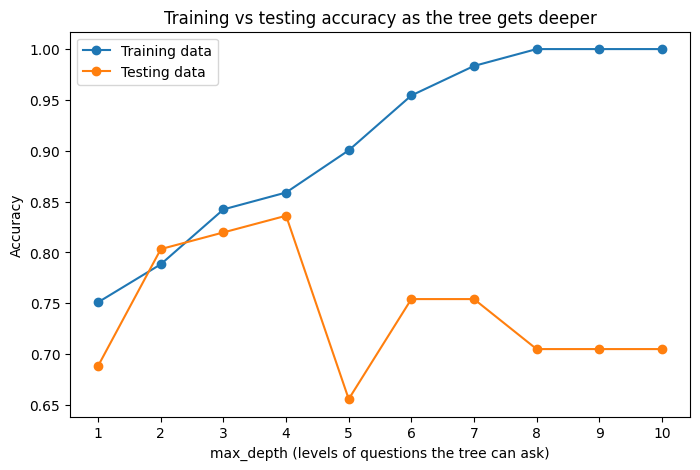

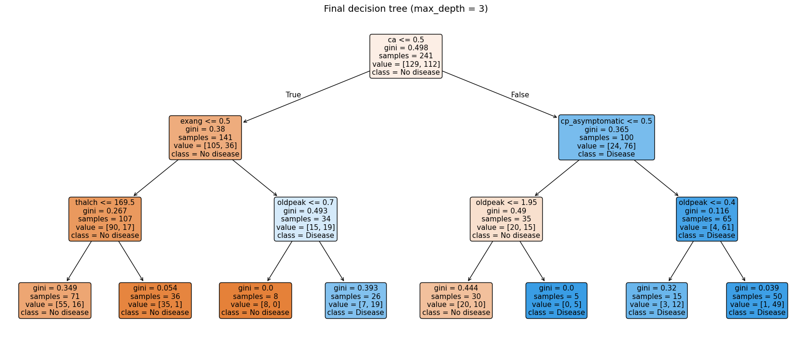

### Results

| Measure | Part 2 result |
| --- | --- |
| Training patients | 241 |
| Testing patients | 61 |
| Test accuracy | Approximately 82% |
| Majority-class baseline accuracy | Approximately 54% |
| Precision | 95% |
| Recall | 64% |

The model correctly identified 18 of the 28 patients with disease and missed 10. Its high precision therefore came with a substantial number of missed cases.

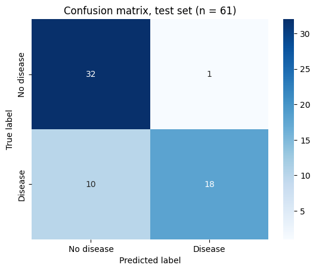

Permutation importance showed that exercise-induced angina, vessel count, ST depression and chest-pain type contributed to the predictions.

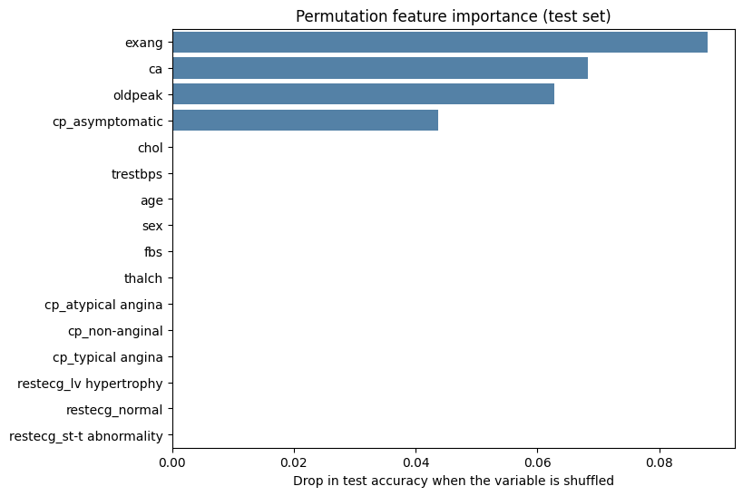

### Limitations and next steps

Keeping vessel count narrowed the sample almost entirely to Cleveland. We also used test performance to help choose tree depth, so the reported test accuracy may be optimistic. A separate validation procedure would provide a more reliable evaluation.

These limitations prompted us to reconsider the missing-data approach in Part 3.

[View the Part 2 notebook](./files/data601/part2.ipynb)

## Part 3: Answering Questions

### Our question

Which patient markers are associated with heart disease, in which direction, and how strongly?

We combined visual analysis, correlations and model interpretation to explain the relationships in plain language.

### Revising the missing-data approach

We dropped four incomplete variables: vessel count (`ca`), thallium test result (`thal`), exercise ST slope (`slope`) and cholesterol (`chol`). After removing remaining incomplete rows, we retained 766 patients from all four hospitals, compared with 302 in Part 2.

The tradeoff was losing potentially useful measurements, particularly vessel count, while retaining a broader sample.

### Exploring the revised sample

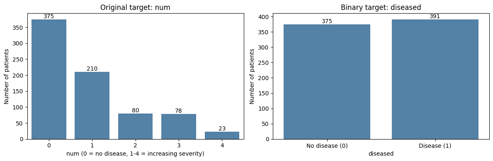

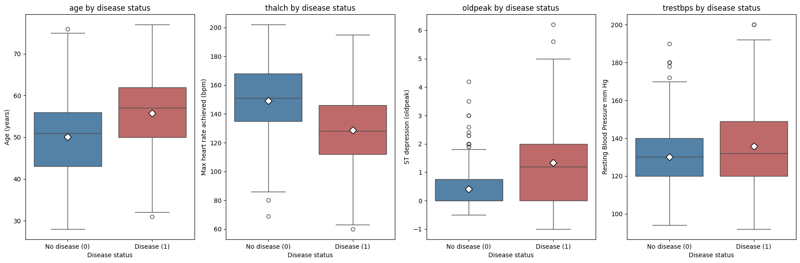

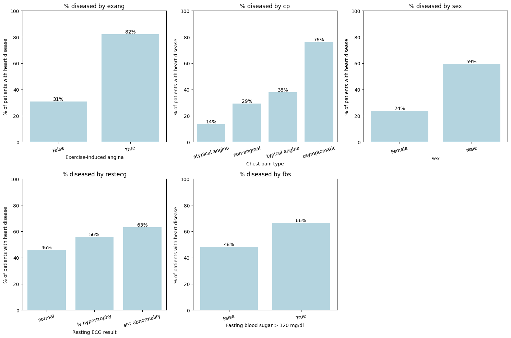

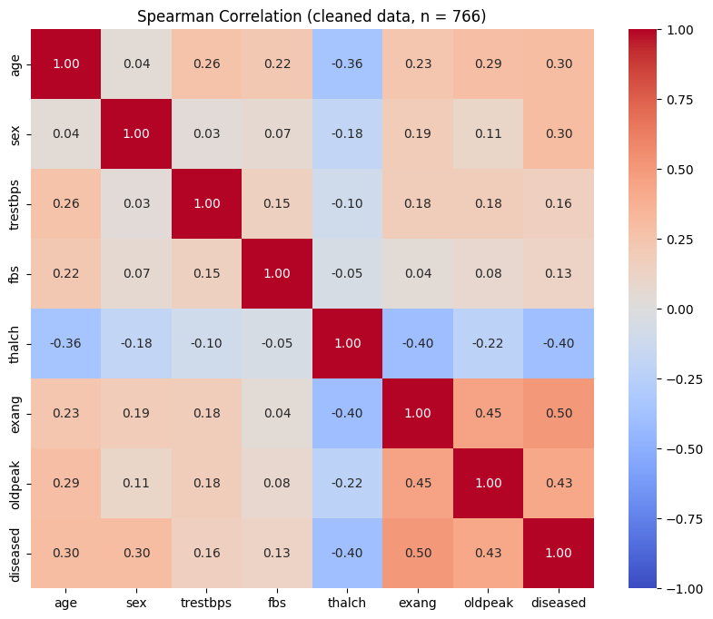

### Model and evaluation

We fitted a decision tree with a maximum depth of 4 using 612 training patients and evaluated it on 154 testing patients.

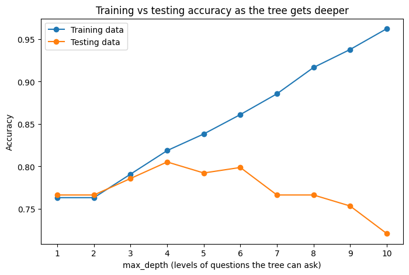

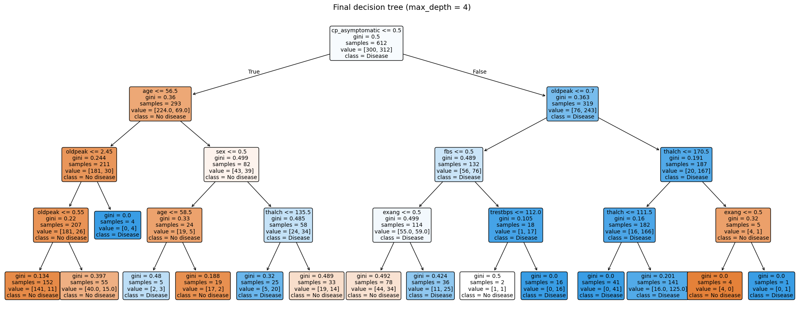

| Measure | Part 3 result |
| --- | --- |
| Patients included | 766 |
| Training patients | 612 |
| Testing patients | 154 |
| Training accuracy | Approximately 82% |
| Test accuracy | Approximately 80.5% |
| Majority-class baseline accuracy | Approximately 51% |
| Precision | Approximately 80% |
| Recall | Approximately 82% |

The model identified 65 of the 79 testing patients with disease, missed 14 and incorrectly flagged 16 patients without disease.

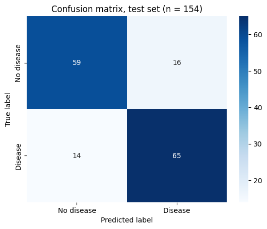

### Interpreting the findings

Chest-pain type and exercise-test measurements provided useful information. Exercise-induced angina and ST depression were positively associated with disease, while maximum heart rate was negatively associated.

A variable's individual correlation did not always match its added value in the tree. Maximum heart rate was associated with disease, but added relatively little once other exercise-test measurements were available.

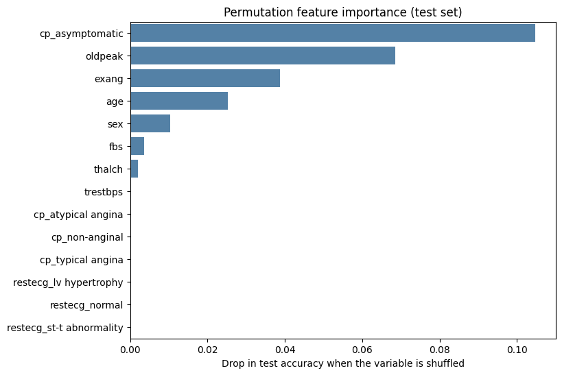

Patients in the asymptomatic chest-pain category had a higher disease proportion in this sample. Referral patterns are one possible explanation, but our analysis did not establish why this occurred.

### What we could conclude

Several clinical markers were associated with heart disease in this dataset. The decision tree helped explain how combinations of measurements separated patients into groups, but the analysis did not establish causation or validate a diagnostic tool.

Part 3 retained more hospitals and had higher observed recall than Part 2. However, the models used different patient samples and test sets, so their scores are not a controlled comparison of modelling approaches.

### Remaining limitations

- The sample consists of patients referred for testing and is predominantly male.
- Missing data were linked to hospital recording practices, which affected who could be included.
- Tree depth was selected using test performance, so the reported accuracy needs independent validation.
- Small tree branches and a limited testing sample make some results uncertain.
- Associations may reflect age, sex, referral practices or overlapping clinical measurements.

Useful next steps include selecting tree depth through cross-validation, comparing the results with logistic regression, and testing on a hospital excluded from training.

[View the Part 3 notebook](./files/data601/part3.ipynb) | [Read the final report](https://github.com/sandrai05/sandrai05.github.io/blob/main/files/data601/final-report.pdf)

## What this project taught us

Data preparation changed the question we could answer and the patients represented in our results. Keeping a useful measurement meant losing most patients outside Cleveland. Dropping it allowed us to study a broader sample, but removed information the earlier model relied on.

We also learned to look beyond accuracy. A model could classify most patients correctly while still missing many of those with disease. Interpreting the confusion matrix and recall made that limitation clear.

## Project files

- [Part 1: Exploratory Data Analysis notebook](./files/data601/part1.ipynb)
- [Part 2: Making Predictions notebook](./files/data601/part2.ipynb)
- [Part 3: Answering Questions notebook](./files/data601/part3.ipynb)
- [Final project report](./files/data601/final-report.docx)

## Data source

[UCI Heart Disease dataset on Kaggle](https://www.kaggle.com/datasets/redwankarimsony/heart-disease-data)

Original dataset: Janosi, Steinbrunn, Pfisterer and Detrano, *Heart Disease*, UCI Machine Learning Repository. [Dataset record](https://doi.org/10.24432/C52P4X).

[Back to home](./)
