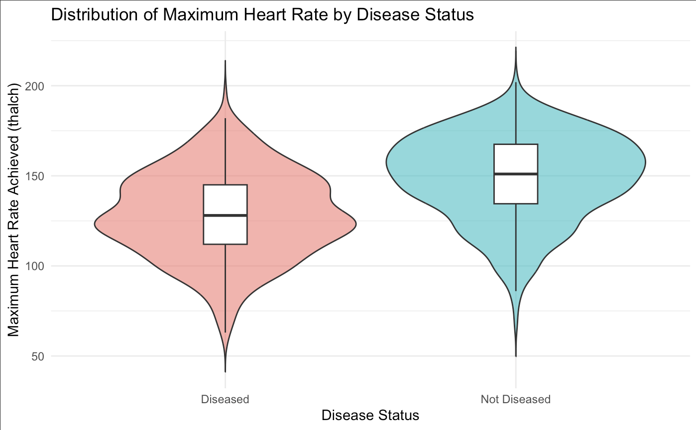
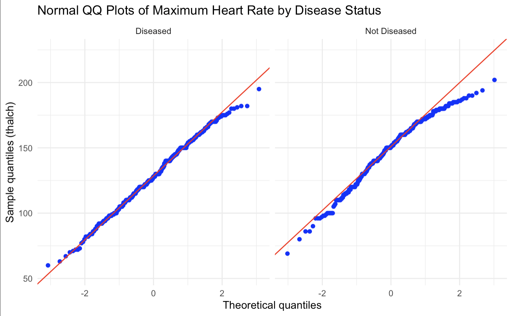
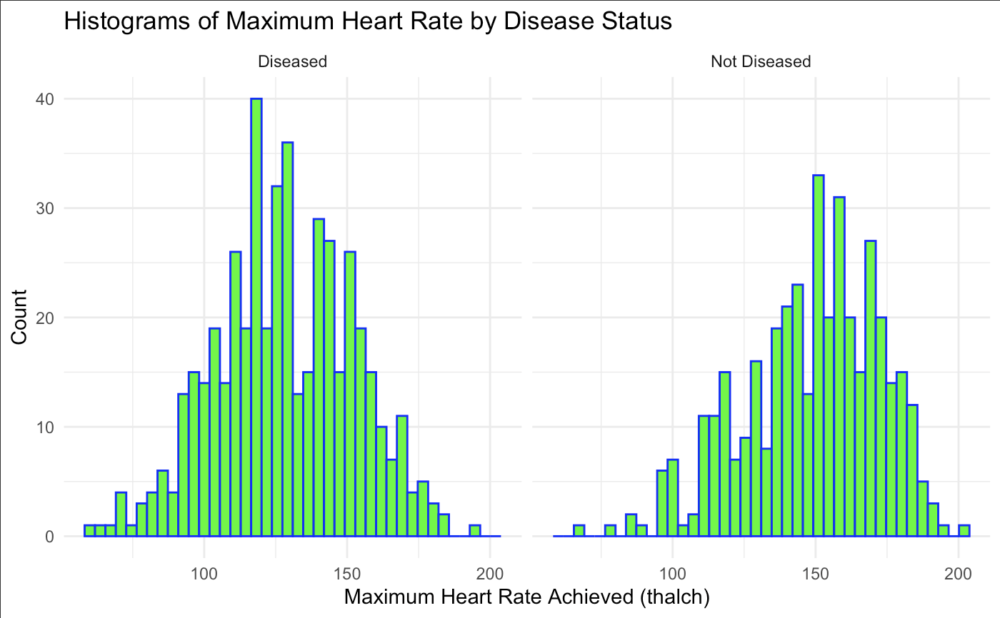
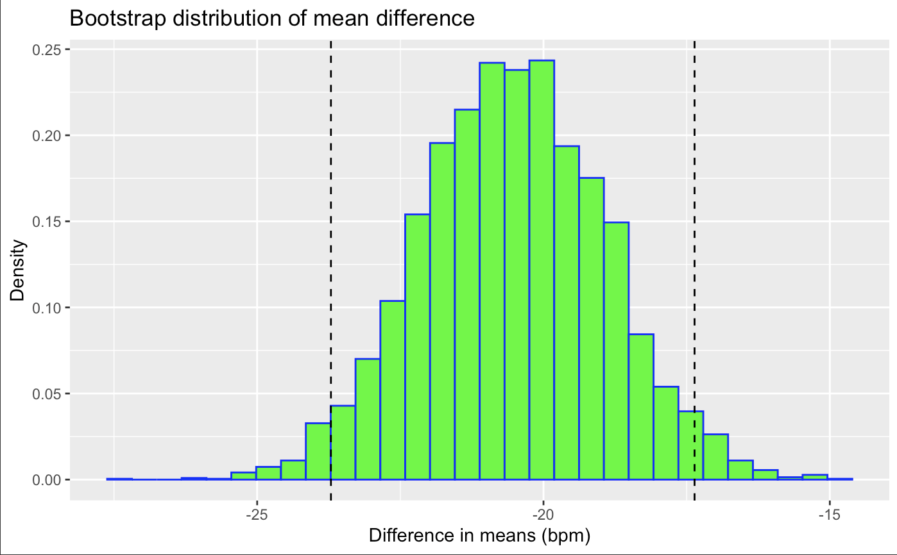
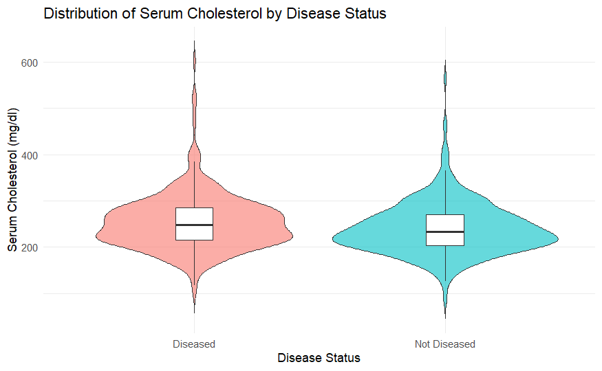
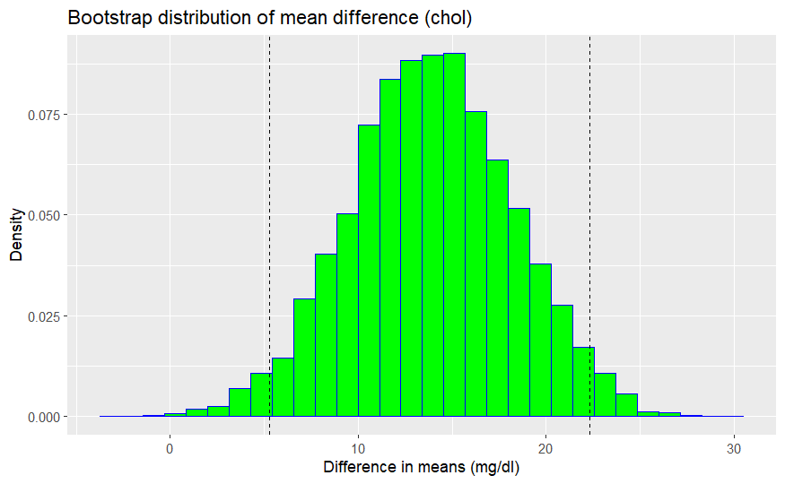
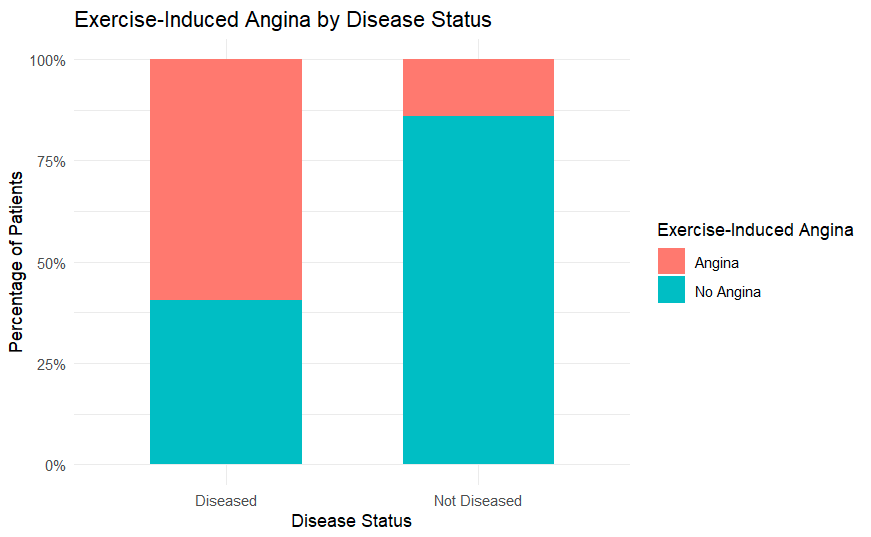
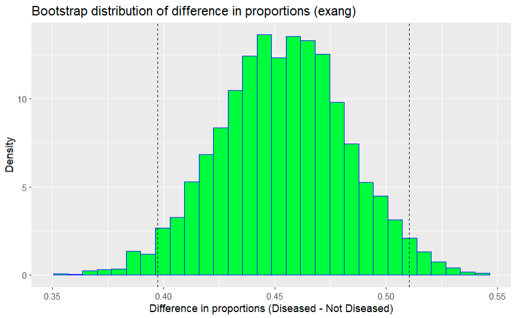
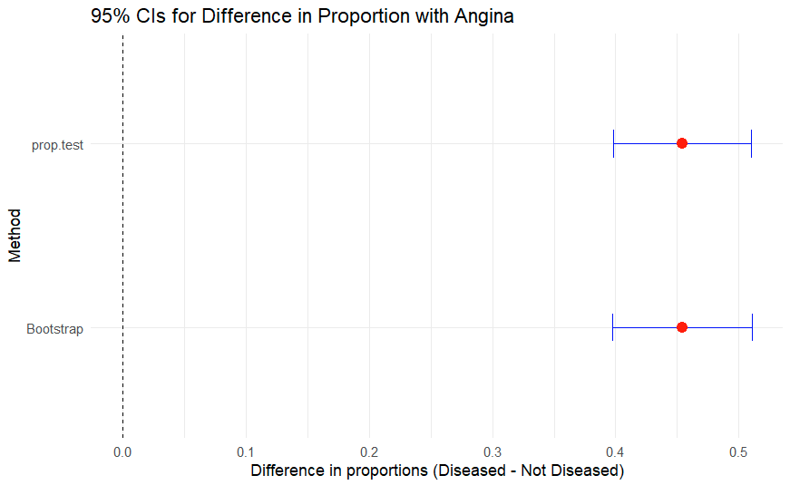

[Back to home](./)

# Detecting Heart Disease
## A Comparative Statistical Analysis of Clinical Markers

**DATA 602: Statistical Data Analysis**  
**University of Calgary | Fall 2026**  
**Group project:** Ahmed Muhammad, Divine Samuel, Joy Umejiego and Sandra Igboanugo

We compared three clinical measurements between patients with and without heart disease: maximum heart rate during exercise, serum cholesterol and exercise-induced angina. For each comparison, we used a hypothesis test and compared its confidence interval with a bootstrap interval based on 5,000 resamples.

All three comparisons showed statistically significant differences in this sample. However, the cholesterol distributions overlapped considerably, illustrating why statistical significance alone does not establish how useful a measurement is for classifying individual patients.

**Tools:** R, RKaggle, readr, dplyr, ggplot2 and mosaic.

[Maximum heart rate](#maximum-heart-rate) | [Cholesterol](#serum-cholesterol) | [Exercise-induced angina](#exercise-induced-angina) | [Project files](#project-files)

## Research questions

1. Does mean maximum heart rate differ between patients with and without heart disease?
2. Does mean serum cholesterol differ between the two groups?
3. Does the proportion experiencing exercise-induced angina differ between the groups?

This project used the same underlying dataset as our [DATA 601 project](./data601-heart-disease.html). Here, we focused on statistical inference and uncertainty around differences between groups.

## Data and preparation

The UCI Heart Disease dataset, obtained through Kaggle, contains 920 patient records and 16 attributes from Cleveland, Hungary, Switzerland and VA Long Beach. The historical records represent patients evaluated for suspected coronary artery disease.

| Variable | Meaning | Analysis |
| --- | --- | --- |
| `thalch` | Maximum heart rate achieved during exercise, in bpm | Difference in means |
| `chol` | Serum cholesterol, in mg/dl | Difference in means |
| `exang` | Whether exercise-induced angina occurred | Difference in proportions |
| `num` | Diagnosis, from 0 for no disease to 4 for increasing severity | Converted to disease present or absent |

We changed zero cholesterol and resting blood pressure values to `NA`, created a binary `diseased` indicator, and renamed `dataset` to `origin` to identify each hospital. Missing values were excluded separately for each analysis, so the number of patients differs between comparisons.

## Statistical approach

For the numerical measurements, we used pooled two-sample t-tests after examining group distributions and variability. For angina, we used a two-proportion test with `prop.test()` and no continuity correction.

For every comparison, the null hypothesis stated that the group means or proportions were equal. The alternative was two-sided: the groups differed. All differences below are calculated as **patients with disease minus patients without disease**.

We also resampled each group with replacement 5,000 times. The 2.5th and 97.5th percentiles of the resulting differences formed a 95% bootstrap percentile interval. This allowed us to compare conventional intervals with a resampling approach that does not assume normally distributed raw measurements. Both approaches still depend on assumptions about sampling and independence.

## Maximum heart rate

### Assumption checks

This analysis included 474 patients with disease and 391 without disease. Group standard deviations were similar: 24.02 and 23.61 bpm, supporting our use of a pooled t-test.

QQ plots showed relatively small departures from the reference lines. The group without disease had some left skew. Given the large group sizes, we treated inference about the difference in means as reasonably supported, subject to the sampling limitations discussed below.

### Results

Patients with disease reached a mean maximum heart rate of approximately **128.3 bpm**, compared with **148.8 bpm** for those without disease. The estimated difference was **−20.5 bpm**.

The t-test gave **t = −12.61**, **863 degrees of freedom** and **p < 2.2 × 10⁻¹⁶**.

| Method | 95% confidence interval for mean difference |
| --- | --- |
| Pooled t-test | −23.74 to −17.34 bpm |
| Bootstrap | −23.71 to −17.36 bpm |

Both intervals were entirely below zero and nearly identical. In this sample, the group with disease reached a substantially lower average maximum heart rate. This group comparison does not establish a diagnostic cutoff for an individual patient.

## Serum cholesterol

### Missing values and assumption checks

Of the 920 patients, 202 had no usable cholesterol reading. This left **346 patients with disease** and **372 without disease**. All 123 patients from Switzerland lacked usable cholesterol values, so that hospital was absent from this comparison.

The group standard deviations were approximately 60.6 and 55.8 mg/dl. Both distributions were right-skewed, but the sample sizes were large. We used a pooled t-test and compared its interval with the bootstrap interval.

### Results

Mean cholesterol was approximately **254.0 mg/dl** in patients with disease and **240.2 mg/dl** in those without. The report estimated the difference at approximately **+13.8 mg/dl**, with **t = 3.19**, **716 degrees of freedom** and **p = 0.0015**.

| Method | 95% confidence interval for mean difference |
| --- | --- |
| Pooled t-test | 5.32 to 22.38 mg/dl |
| Bootstrap | 5.27 to 22.34 mg/dl |

Both intervals excluded zero. The direction of the difference was also positive at each of the three hospitals with usable data. However, the difference was small relative to variation within the groups, so their cholesterol distributions overlapped heavily.

This was an important distinction: a statistically significant difference in group averages does not necessarily mean a variable separates individuals well. Missing data also changed the hospital mix represented in this analysis.

## Exercise-induced angina

### Counts and test conditions

This comparison included **474 patients with disease** and **391 without disease**. Fifty-five records lacked an angina value, including 53 from VA Long Beach.

| Disease status | Angina | No angina | Total |
| --- | ---: | ---: | ---: |
| Disease present | 282 | 192 | 474 |
| Disease absent | 55 | 336 | 391 |

The cell counts were large enough to support a normal-approximation comparison of proportions, assuming independent observations.

### Results

Exercise-induced angina occurred in **59.5%** of patients with disease and **14.1%** of those without disease, a difference of approximately **45.4 percentage points**.

The two-proportion test gave **χ² = 185.93**, **1 degree of freedom** and **p < 0.001**. Angina occurred about **4.2 times as often** in the disease group within this sample.

| Method | 95% confidence interval for difference in proportions |
| --- | --- |
| Two-proportion test | 39.8 to 51.0 percentage points |
| Bootstrap | 39.7 to 51.1 percentage points |

The intervals closely agreed and were entirely above zero, supporting an association between disease status and exercise-induced angina in this sample.

## Findings together

| Clinical marker | With disease | Without disease | Estimated difference |
| --- | ---: | ---: | ---: |
| Mean maximum heart rate | 128.3 bpm | 148.8 bpm | −20.5 bpm |
| Mean serum cholesterol | 254.0 mg/dl | 240.2 mg/dl | Approximately +13.8 mg/dl |
| Exercise-induced angina | 59.5% | 14.1% | +45.4 percentage points |

*Means and differences were rounded separately in the report, so subtracting displayed means may give a slightly different rounded difference.*

Conventional and bootstrap confidence intervals closely agreed for all three comparisons. The exercise measurements showed more pronounced group differences, while cholesterol had substantial overlap between groups. Comparing maximum heart rate and cholesterol relative to their own variability also showed a larger standardized difference for heart rate.

## Limitations

- **Observational data:** These findings show associations. They do not establish that a measurement causes disease.
- **Sample selection:** Patients were already referred for testing. The sample was not randomly selected from the general population.
- **Hospital differences:** Recording practices and patient characteristics varied between hospitals. Missing-data exclusions changed the mix of patients analyzed.
- **Historical records:** The data reflect patients treated in the early 1980s and may not represent current populations.
- **Unadjusted comparisons:** We did not adjust these comparisons for age, sex or relationships among clinical measurements.
- **Combined severity levels:** Grouping all disease levels together hides potential differences between mild and severe disease.

Agreement between bootstrap and conventional intervals does not remove selection bias or establish independence. This project also did not assess whether any marker would work as a stand-alone screening or diagnostic tool.

## What we learned

The project helped us connect hypothesis tests with the size and uncertainty of a difference. Looking at confidence intervals and distributions gave us more information than a p-value alone.

It also reinforced the importance of examining missing values before interpreting results. Excluding unusable cholesterol readings removed an entire hospital, so that comparison represented a different group of patients from the other analyses.

## Project files

- [Read the final report PDF](./files/files/data602/final-report.pdf)
- [View the final report in GitHub's PDF viewer](https://github.com/sandrai05/sandrai05.github.io/blob/main/files/files/data602/final-report.pdf)
- [Download the presentation](./files/files/data602/presentation.pptx)

The final report includes the R code appendix. The page above summarizes the analysis; the PDF preserves the supplied report.

## Data source

[UCI Heart Disease dataset on Kaggle](https://www.kaggle.com/datasets/redwankarimsony/heart-disease-data)

Original dataset: Janosi, Steinbrunn, Pfisterer and Detrano, *Heart Disease*, UCI Machine Learning Repository. [Dataset record](https://doi.org/10.24432/C52P4X).

[Back to home](./)
